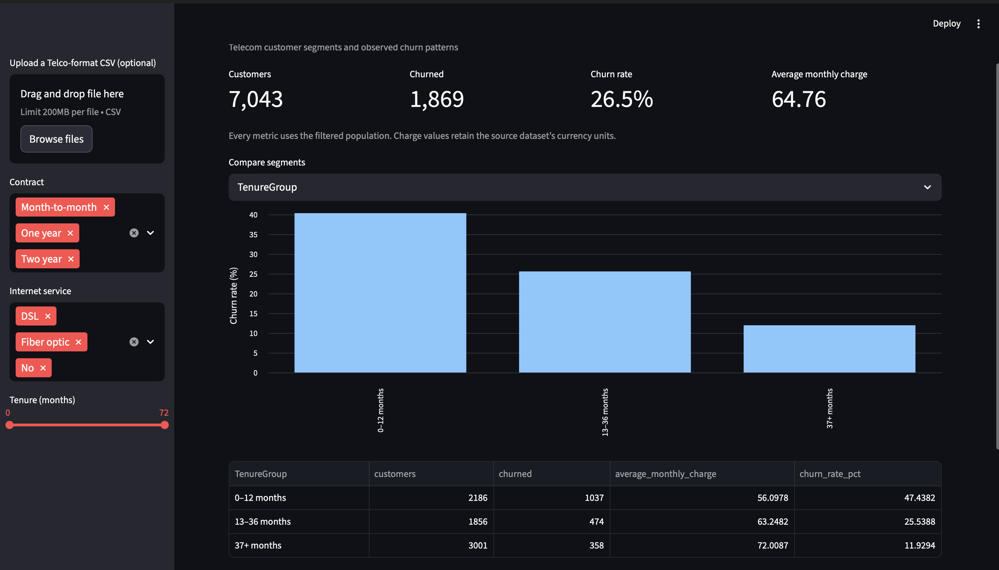
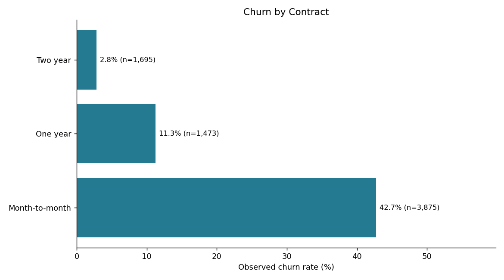
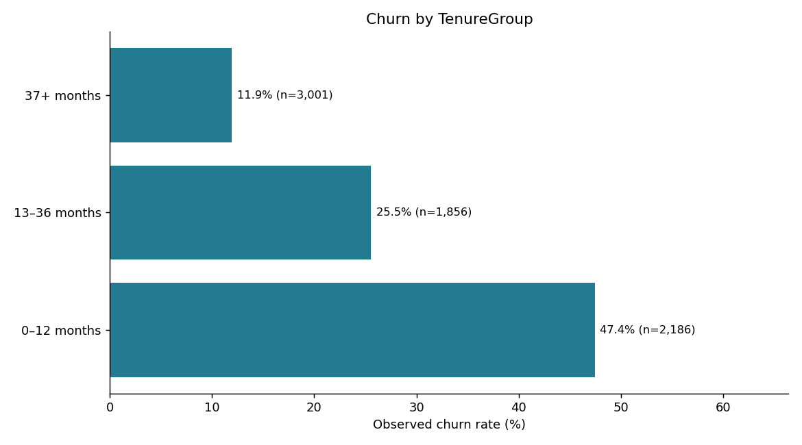

# Customer Retention & Segmentation Analysis

Telecom customer churn analysis using Python, SQL and Streamlit. The project compares customer segments to identify retention patterns and support business decisions.

## Features

- Data cleaning and validation
- Customer segmentation by tenure, contract, payment method and services
- Interactive dashboard with filters and CSV downloads
- Automated charts, KPI summaries and SQL exports

## Tech Stack

Python · Pandas · NumPy · Matplotlib · Streamlit · SQLite

## Key Results

| Metric | Value |
|---|---:|
| Customers analyzed | 7,043 |
| Churned customers | 1,869 |
| Overall churn rate | 26.54% |
| Churn rate: 0–12 months | 47.44% |
| Churn rate: 13–36 months | 25.54% |
| Churn rate: 37+ months | 11.93% |

Early-tenure customers show higher observed churn. This suggests investigating onboarding and early service experiences before testing retention interventions.

## Dashboard & Charts

### Dashboard
<!-- Replace the path below with your image path or URL. -->



### Churn by Contract
<!-- Replace the path below with your image path or URL. -->



### Churn by Tenure
<!-- Replace the path below with your image path or URL. -->



## Run Locally

Use Python 3.11 or 3.12. Open a terminal in the project folder.

**Windows**
```powershell
python -m venv .venv
.\.venv\Scripts\python.exe -m pip install -r requirements.txt
.\.venv\Scripts\python.exe analysis.py
.\.venv\Scripts\python.exe -m streamlit run app.py
```

**macOS / Linux**
```bash
python3 -m venv .venv
.venv/bin/python -m pip install -r requirements.txt
.venv/bin/python analysis.py
.venv/bin/python -m streamlit run app.py
```

Open http://localhost:8501 to view the dashboard.

## Project Files

| Path | Contents |
|---|---|
| `analysis.py` | Cleaning, segmentation and chart generation |
| `app.py` | Streamlit dashboard |
| `data/` | Dataset and source license |
| `results/` | Charts, summaries, findings and SQLite database |
| `sql/` | Analysis queries |
| `docs/` | Business notes and verification |
| `tests/` | Data validation tests |
| `images/` | README screenshots |

## Scope

Segments use predefined tenure groups, not machine-learning clustering. Results describe associations in a sample dataset; they do not establish causes or demonstrate actual churn reduction.

## Credits

- Dataset: [IBM Telco Customer Churn](https://github.com/IBM/telco-customer-churn-on-icp4d). Source license included in `data/SOURCE_LICENSE.txt`.
- Project inspiration: [Harsh Belekar’s Customer Segmentation Analysis](https://github.com/Harsh-Belekar/Customer-Segmentation-Analysis). Code and documentation were written independently.